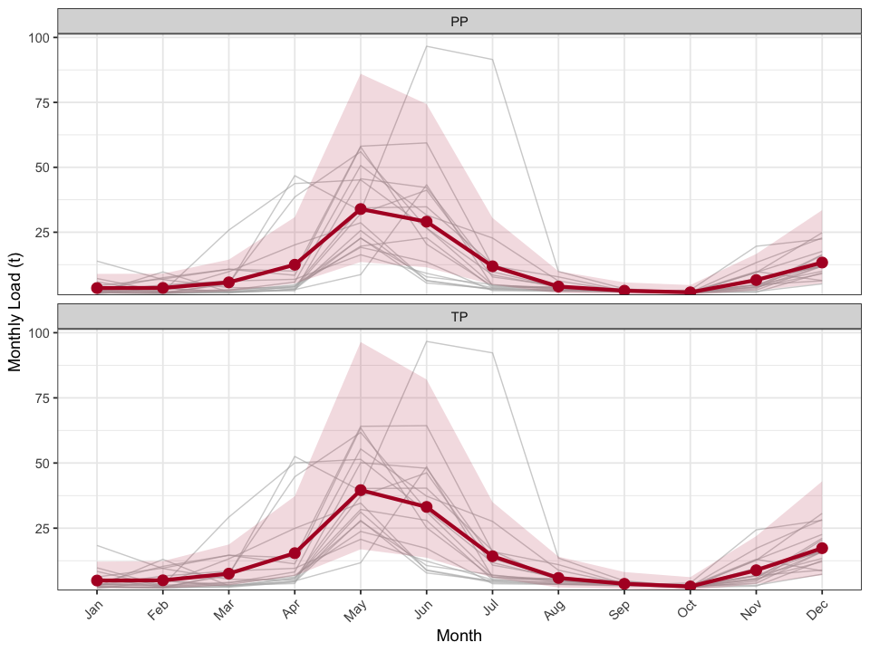
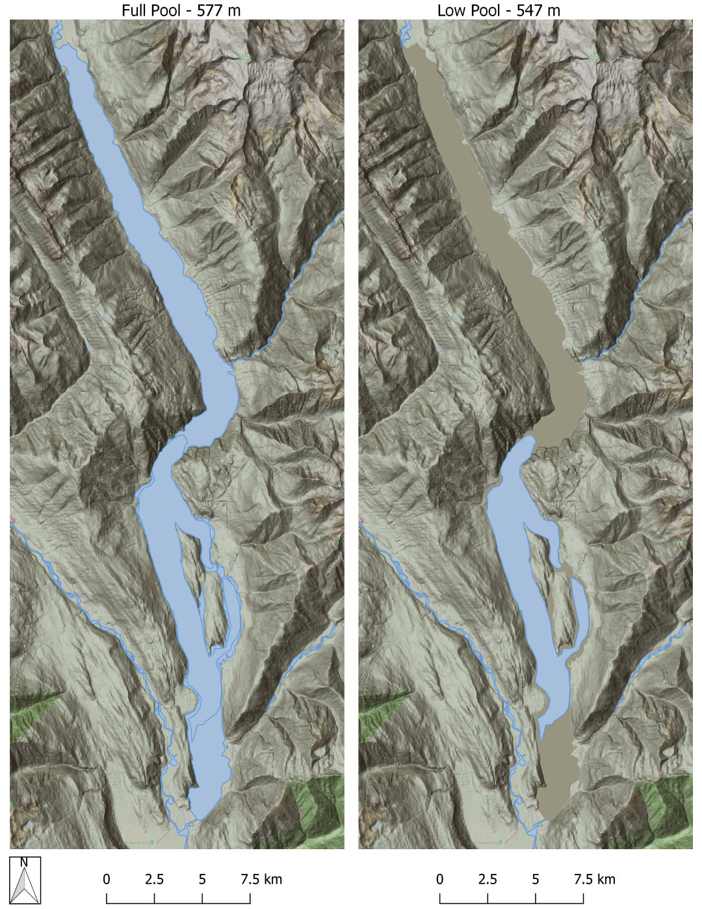
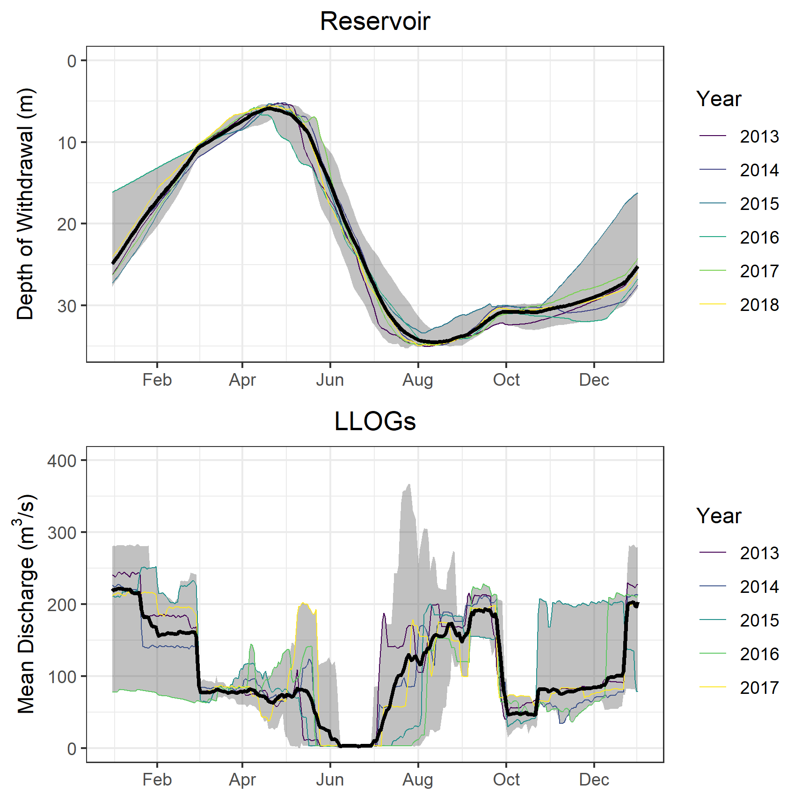
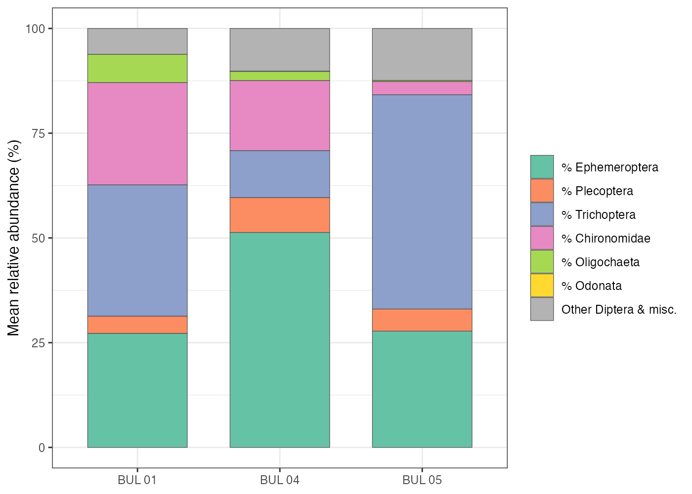
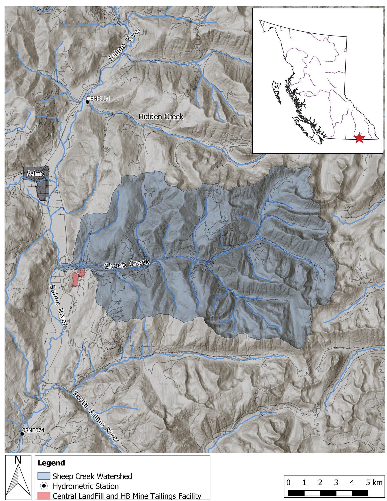
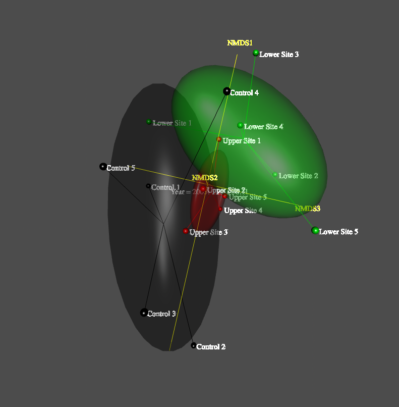
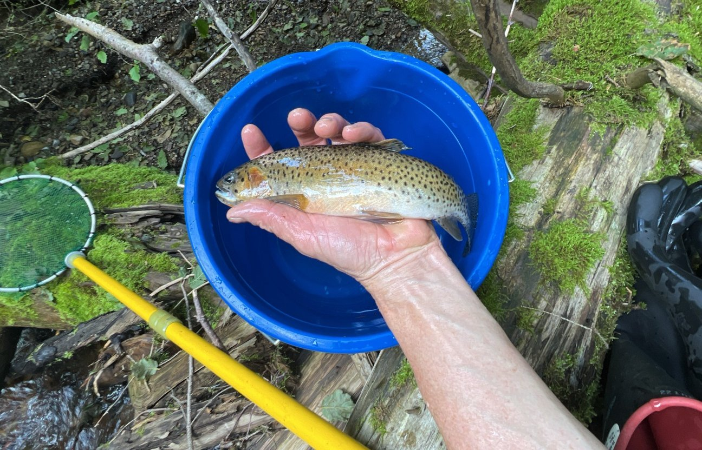

We provide data analysis, monitoring design, and reporting for long-term aquatic programs — from nutrient loading in large regulated reservoirs to biological impact assessment in small tributaries.

## Kootenay Lake & Arrow Lakes Nutrient Restoration Program

Data analysis and reporting for the Nutrient Restoration Program — a long-running initiative that applies limiting nutrients to Kootenay Lake and Arrow Lakes Reservoir to counter cultural oligotrophication caused by dam construction and operation. Our work quantifies natural nutrient loading alongside fertilizer additions, comparing dissolved phosphorus and nitrogen inputs across seasons and systems to assess the relative contribution of fertilization to biologically available nutrient supply during the growing season.

The analysis integrates hydrometric, water quality, and fertilization records spanning decades — bridging data from provincial monitoring systems, cross-border partnerships, and intensive sampling campaigns. Watershed delineation identifies unmonitored catchment contributions. Concentration-discharge modelling with uncertainty quantification provides loading estimates that inform adaptive management of fertilization timing and volumes to support kokanee populations.

## Duncan Reservoir Kokanee Stock Assessment

Data analysis, mapping and reporting to support large lake specialists on a multi-year synthesis report for a water use planning study. Reporting incorporated results and data from multiple water use planning projects in the Columbia Basin to explore impacts and mitigation strategies related to flow regulation and water impoundment in the Duncan River watershed. We built tools in R to automate the processing of hydroacoustic fish density outputs as well as associated water quality, zooplankton, and hydrometric data.

## Neexdzii Kwah Benthic Invertebrate Assessment

Baseline assessment of stream health along the Neexdzii Kwah (Upper Bulkley River) mainstem, undertaken with the Society for Ecosystem Restoration in Northern BC (SERNbc) and the Wet'suwet'en Treaty Office Society to fill a data gap identified during [companion restoration planning research on the watershed](https://www.newgraphenvironment.com/restoration_wedzin_kwa_2024/). Three mainstem sites were sampled in triplicate following the CABIN wadeable streams protocol, with taxonomic processing by Cordillera Consulting.

We combined the 2025 field data with historical benthic samples from the same reach (2004 and 2018) and over five decades of BC Environmental Monitoring System (EMS) water quality records — 1972 to 2024, more than one hundred stations in the watershed. Records were grouped by source — Houston wastewater treatment plant, Knockholt Landfill, Equity Silver Mine, and the mainstem and tributary stations — in a reproducible workflow that updates as new data arrives. Statistical analysis combined community composition, feeding strategies, pollution-tolerance scores, and multivariate ordination. The report proposes an expanded monitoring design including priority tributaries and an upstream reference site.

[**Read the report →**](https://www.newgraphenvironment.com/neexdzii_kwa_benthic_2025/)

## Sheep Creek Biological Impact Assessment

Environmental impact assessment of landfill leachate on aquatic values in a major tributary to the Salmo River. Water quality impacts quantified using analysis of benthic macro-invertebrate and periphyton communities. Reproducible workflows conducted in R including standardization of multi-year project data and amalgamation within a sqlite database.

Non-metric Multidimensional Scaling (NMDS) ordination models incorporated in both report 2D plots and interactive 3D deliverables to communicate community assemblage patterns to environmental managers.

## Fish & Habitat Assessment

We carry out stream classifications, rapid and detailed habitat assessments, Fish Habitat Assessment Procedures, and electrofishing for fish presence, density and movement, and submit the results to the provincial fish database (FISS).

