Our analytical tools, data, and methods are publicly available on GitHub. We work in the open wherever transparency improves science. The tools are built and extended through our partner programs, so each project strengthens the tools the next one uses.

They answer four questions about a watershed. Open data catalogues feed the analysis, and the analysis becomes the field maps crews carry and the reports that rebuild when new data arrives.

 

## Where is the habitat, and what's keeping fish from it?

For restoration planning, the first questions are where each species' habitat is and which barriers cut fish off from it. Field results flow back into the answer.

### link — habitat potential, species by species

Our habitat connectivity model, link, maps the intrinsic habitat potential of streams for each species: where spawning and rearing habitat can be, whether fish can reach it, and which barrier is in the way. The habitat rules can be tuned for each species and tested against where fish have actually been found. It builds on the methods of bcfishpass, the established fish passage model for BC.

- [Documentation](https://www.newgraphenvironment.com/link/) | [Source](https://github.com/NewGraphEnvironment/link)

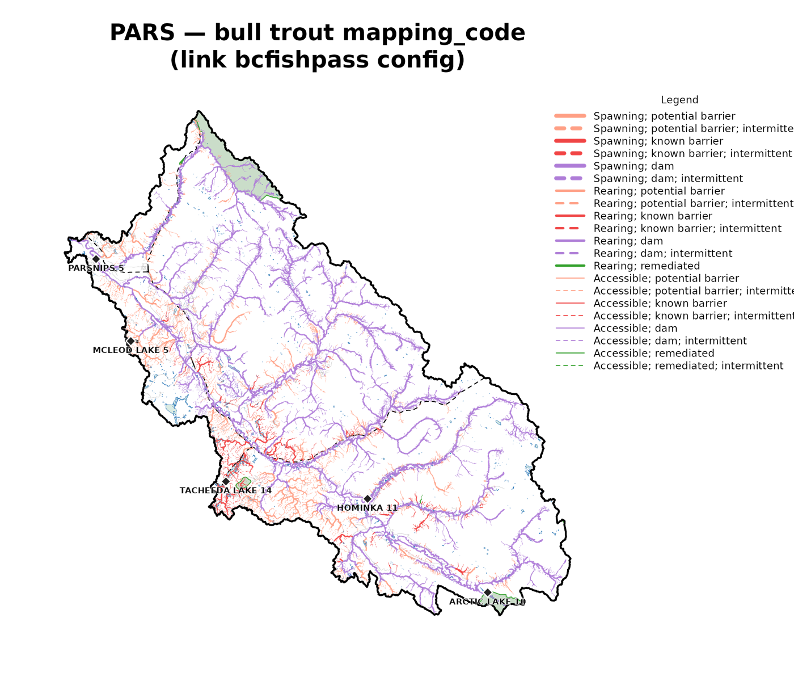

 

### fresh — the stream network engine

Our stream network engine, fresh, does the work underneath. It breaks the network at barriers and rates each stretch of stream as spawning or rearing habitat, lakes and wetlands included, from its gradient and its size or flow. It runs on BC's Freshwater Atlas, building on [fwapg](https://smnorris.github.io/fwapg/), which loads the Atlas into a spatial database.

- [Documentation](https://www.newgraphenvironment.com/fresh/) | [Source](https://github.com/NewGraphEnvironment/fresh)

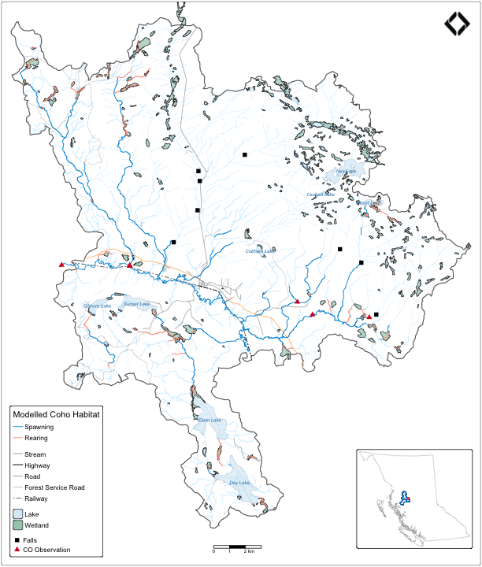

 

### wet — flow and water temperature

Our stream flow tool, wet, estimates mean annual and monthly flow for every stream in the Freshwater Atlas, checked against hydrometric gauges. At gauging stations it adds daily flow and water temperature.

The flow can feed the habitat rules. Our climate analysis tool, cd (below), compares flow during key life stages, such as chinook migration and spawning, with long-term normals, and water temperature with the recent record.

- [Documentation](https://www.newgraphenvironment.com/wet/) | [Source](https://github.com/NewGraphEnvironment/wet)

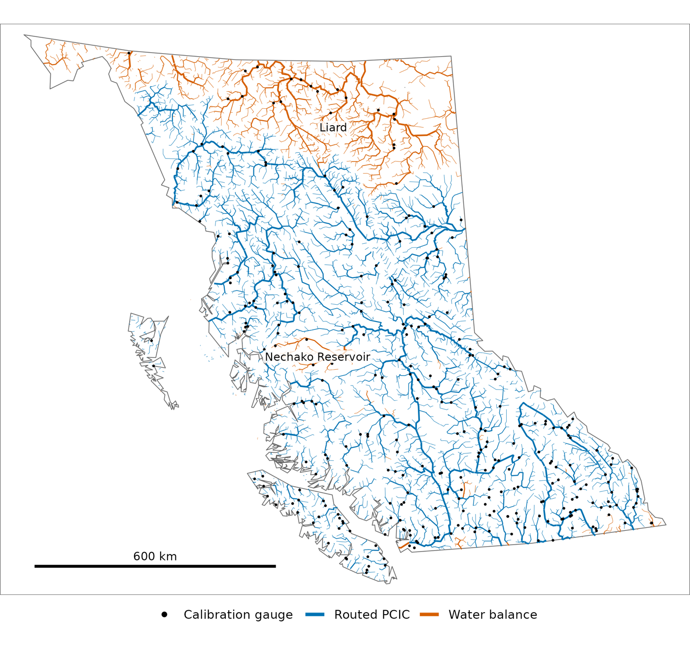

 

---

 

## Where is the floodplain, what did it look like before, and what has changed?

The floodplain is where a river stores water, builds side channels and grows the wood that becomes its pools and cover. Restoring at the scale of the loss means seeing the whole floodplain: where it is, its condition before clearing and channelisation, and what is changing now.

### flooded — where the floodplain is

Our floodplain mapping tool, flooded, maps the floodplain from elevation data and the stream network, from a narrow version to a wide one. Run on coarse elevation data and again on lidar, the difference points to the roads, rail grades, dykes and fill that may cut a river off from its floodplain. That shows **where to look, and where to act**: fill removal, dyke breaches, crossing installations.

- [Documentation](https://www.newgraphenvironment.com/flooded/) | [Source](https://github.com/NewGraphEnvironment/flooded)

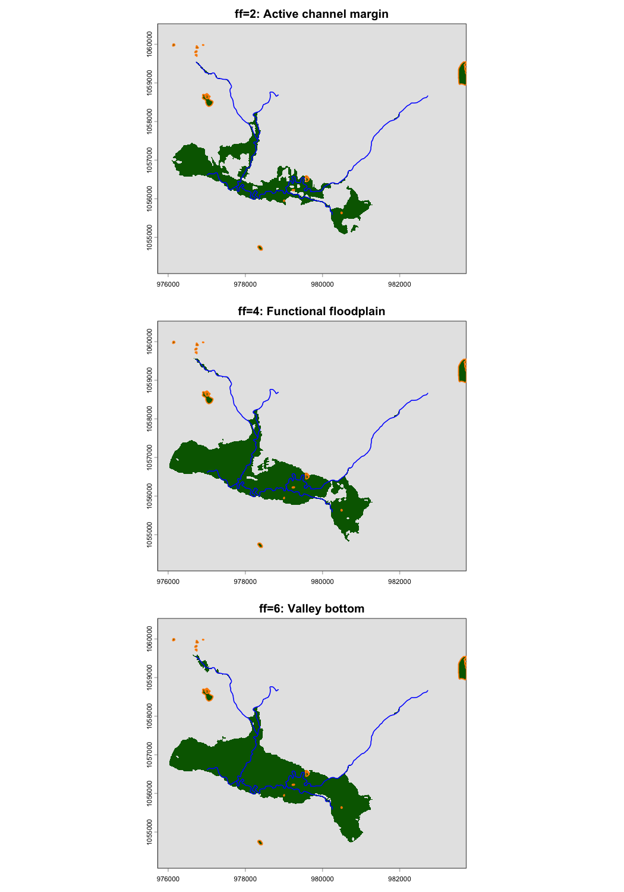

 

### drift — what has changed

Our land-cover change tool, drift, measures how the land inside a floodplain changed between any two years that free satellite land-cover maps cover. It tags each change with what it overlaps in any mapped layer, such as fire or harvest. It is a screening tool: each change it finds is a place to check, not confirmed loss.

- [Documentation](https://www.newgraphenvironment.com/drift/) | [Source](https://github.com/NewGraphEnvironment/drift)

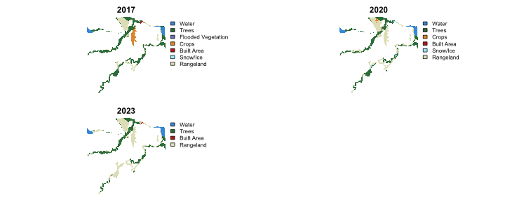

 

### Floodplain change catalogue

Brings link, flooded and drift together for whole watershed groups: the floodplain along fish-accessible streams, tree loss and gain inside it from 2017 to 2023, and how much of that loss coincides with fire or harvest. It loads straight into QGIS, R or Python, and the code that builds it is open.

**A screening tool for finding where to look.** It has not been field-validated, and watershed groups can't be compared with each other on hectares lost.

- [Floodplains](https://www.newgraphenvironment.com/floodplains/) | [Catalogue](https://www.newgraphenvironment.com/stac_floodplains_bc/) | [Source](https://github.com/NewGraphEnvironment/floodplains)

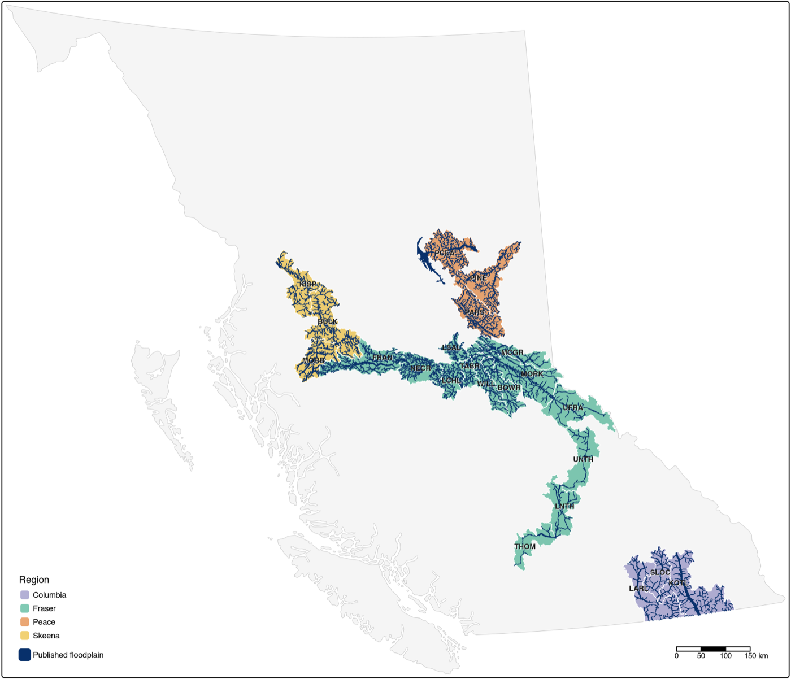

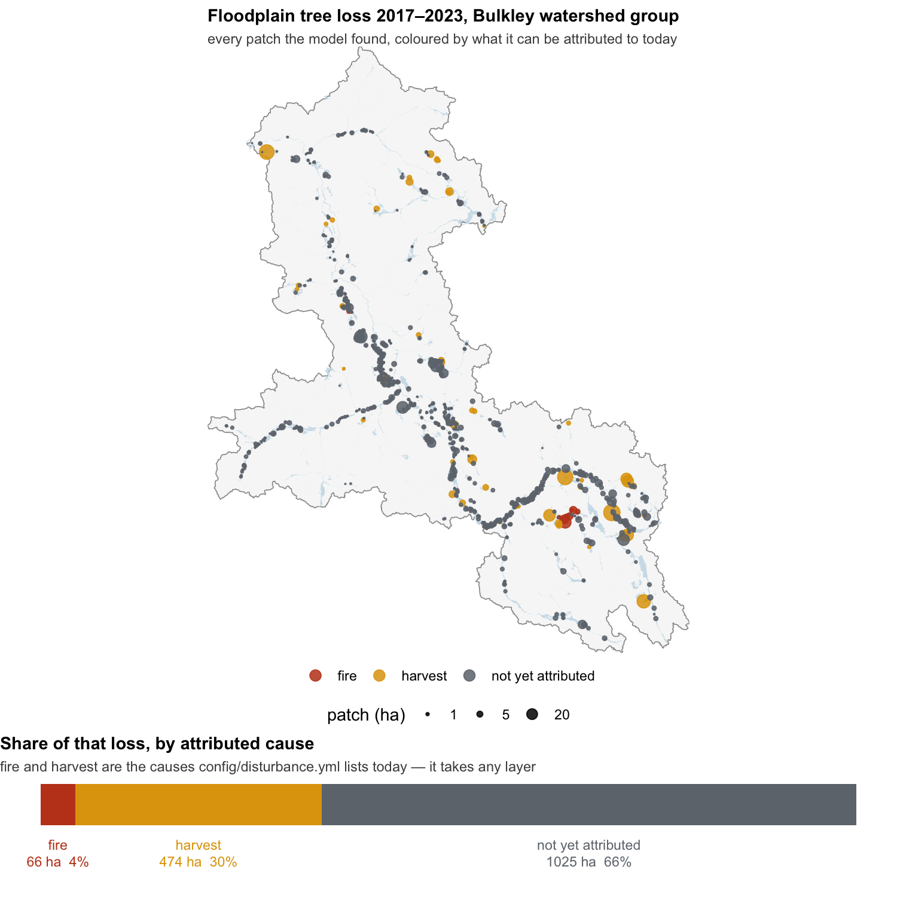

 

### fly — historic airphotos

Our airphoto tool, fly, finds the fewest historic provincial airphotos that cover a site, downloads them and places each on the map by its estimated ground footprint. They show the valley as it was decades ago, an earlier condition to compare today's against. Georeferenced photos are served in our airphoto catalogue, [stac_airphoto_bc](https://www.newgraphenvironment.com/stac_airphoto_bc/).

- [Documentation](https://www.newgraphenvironment.com/fly/) | [Source](https://github.com/NewGraphEnvironment/fly)

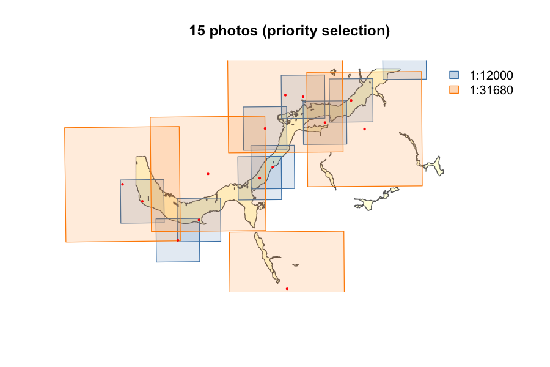

 

### cd — climate departure

Our climate analysis tool, cd, measures how far a watershed's climate has moved from a baseline since 1950: temperature, precipitation, drying, soil moisture and snowpack. It also gives the trend in any yearly series, such as flow from wet. This is the climate context for deciding which watersheds and life stages are under the most pressure.

- [Documentation](https://www.newgraphenvironment.com/cd/) | [Source](https://github.com/NewGraphEnvironment/cd)

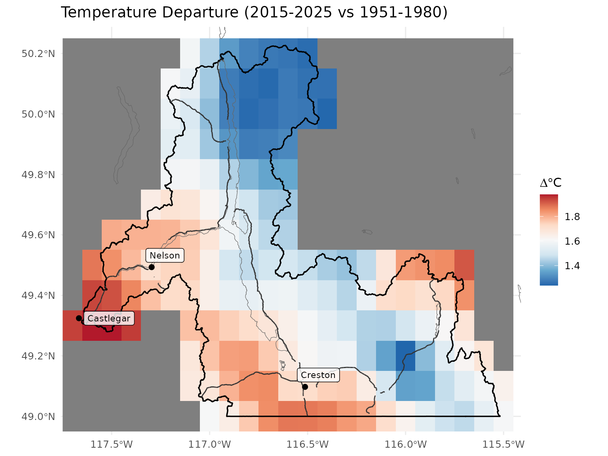

 

---

 

## What do the ground and water look like now?

Understanding a floodplain means seeing it as it is now and as it was. We built open catalogues of provincial lidar and our own drone imagery, and an open archive of the hydrometric record, so this data can be found and loaded directly. They take down the barriers to sharing it: anyone can find imagery and elevation data by place, by script or by hand in QGIS, query the station records by script, and pull either into a model, a report or a map. Partners and practitioners can see for themselves what is happening on their rivers.

### BC lidar, ready to query

LidarBC elevation tiles across the province, searchable by place and date: bare earth and, where published, surface models, updated monthly, with an index of the raw point clouds. Bare earth shows side channels, old channels and the fill built across a river's path. The point clouds give the height of the streamside forest, and where it has been cleared.

- [Elevation catalogue](https://www.newgraphenvironment.com/stac_dem_bc/) | [Point cloud catalogue](https://www.newgraphenvironment.com/stac_pointcloud_bc/)

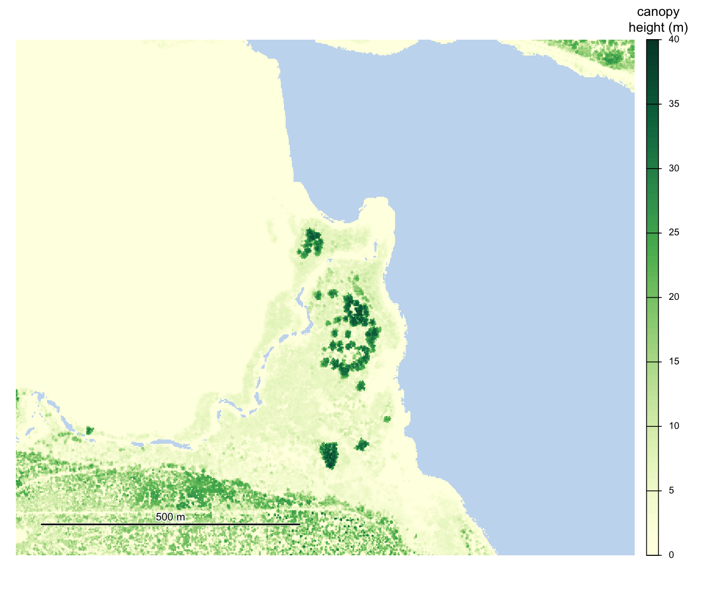

 

### Drone imagery

Our drone flights, catalogued by watershed and year: orthomosaics plus surface and terrain models. Flights can be planned from the floodplain maps, and the imagery comes back into the catalogue for site baselines and before-and-after monitoring of restoration works.

- [Catalogue](https://www.newgraphenvironment.com/stac_uav_bc/) | [Viewer](https://viewer.a11s.one) | [Source](https://github.com/NewGraphEnvironment/stac_uav_bc)

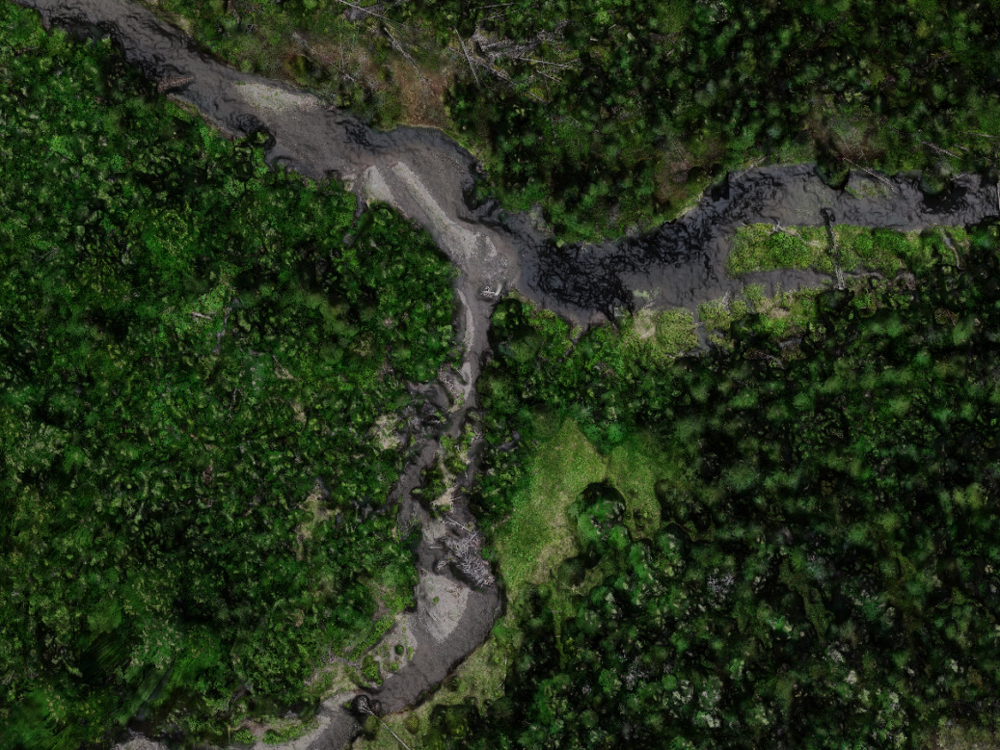

 

### water-temp-bc — water temperature, flow and water level

Our hydrometric archive, water-temp-bc, holds water temperature, flow and water level from federal hydrometric stations across BC, refreshed monthly and combined with the historic record, ready to query from R.

This data feeds collaborative science with [Poisson Consulting](https://www.poissonconsulting.ca/) and [Hillcrest Geographics](https://hillcrestgeo.ca/) that is advancing fish habitat modelling across the province. That includes spatial stream network temperature modelling ([Skeena 2025](https://www.poissonconsulting.ca/f/1130667589), [Nechako 2022](https://www.poissonconsulting.ca/f/1295467017)) and channel width regression models.

- [Data](https://www.newgraphenvironment.com/water-temp-bc/) | [Source](https://github.com/NewGraphEnvironment/water-temp-bc)

 

### Open catalogues, and the recipe for building them

Each catalogue is two things: the data, and the public code that builds it, a worked example others can follow to build their own. We don't need to be the only source of this data. Ours are served at [images.a11s.one](https://images.a11s.one) and can be searched from R, Python or QGIS 3.42+ through the open STAC standard.

Our catalogue loader, stacs, puts catalogues into that search service and checks that every record arrived intact.

- [stacs documentation](https://www.newgraphenvironment.com/stacs/) | [Source](https://github.com/NewGraphEnvironment/stacs)

| Catalogue | What it holds |
|-----------|---------------|
| [**stac_dem_bc**](https://github.com/NewGraphEnvironment/stac_dem_bc) | LiDAR elevation models, bare earth and surface; province-wide, updated monthly |
| [**stac_pointcloud_bc**](https://github.com/NewGraphEnvironment/stac_pointcloud_bc) | LidarBC point cloud files (an index, not a copy); province-wide |
| [**stac_floodplains_bc**](https://github.com/NewGraphEnvironment/stac_floodplains_bc) | Floodplains and land-cover change, 2017–2023; by watershed group |
| [**stac_airphoto_bc**](https://github.com/NewGraphEnvironment/stac_airphoto_bc) | Historic aerial photograph thumbnails (1967–2019), georeferenced; selected watersheds |
| [**stac_uav_bc**](https://github.com/NewGraphEnvironment/stac_uav_bc) | Our drone imagery; by project |

 

---

 

## Into the field and back

We take the planning into the field. For each program we build a custom field system: styled map projects of the watershed carrying our analysis and provincial data, and digital forms that work offline on phones and tablets. The whole crew works in one shared project, and changes sync between field and office.

Forms cover fish passage assessment, habitat confirmation, effectiveness monitoring, restoration site investigation, eDNA sampling and benthic invertebrate collection. Where possible, data is structured for direct submission to the provincial and federal databases: FISS for fish, PSCIS for stream crossings and CABIN for benthic invertebrates. What crews collect flows back into the models it came from: assessments and habitat confirmations feed link's barrier decisions.

We also build the capacity of field teams to navigate to sites, collect data to standard, and interpret what they find.

 

### Dynamic reporting

One set of source files produces both an interactive online report and a print-ready PDF, with maps, figures, tables, cross-references and citations. When new data arrives or methods are refined, the report rebuilds. Every change is tracked, and most reports are publicly accessible. Our citation checker, [cred](https://www.newgraphenvironment.com/cred/), finds the best-matching passage for each citation, or the abstract where no source file is attached, so it can be reviewed.

See live reports in our [Watershed Restoration & Conservation](/project/watershed_restoration_fish_passage/) and [Aquatic Monitoring & Assessment](/project/aquatic_monitoring_assessment/) work.
