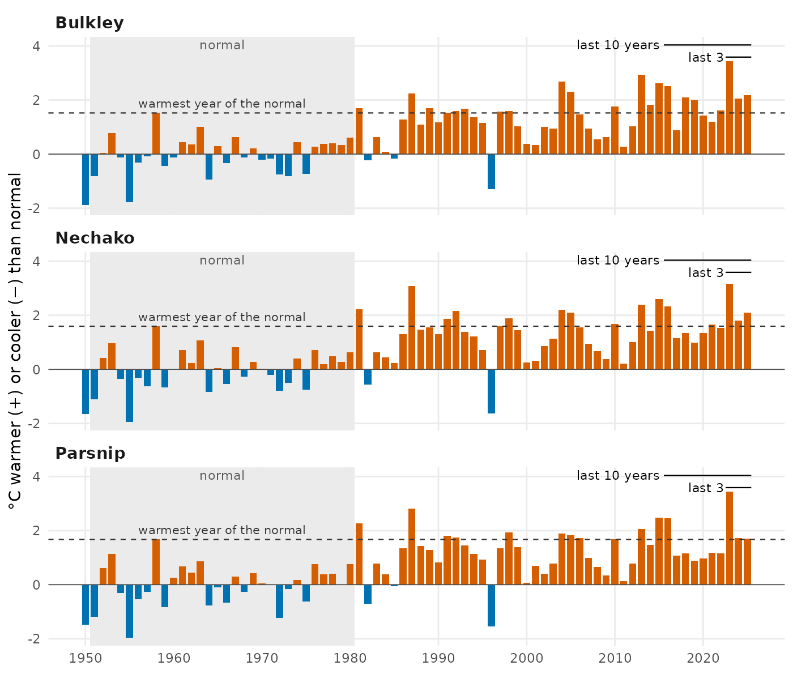

Our analytical tools, data, and methods are publicly available on GitHub. We work in the open wherever transparency improves science. The tools are built and extended through our partner programs, so each project strengthens the tools the next one uses. For how the pieces fit together, from fish evidence to the floodplain, see [Habitat rules, tested and carried onto the floodplain](https://www.newgraphenvironment.com/new_graphiti/posts/2026-11-01-habitat-rules-tested/).

## Where is the habitat, and what is limiting it?

Habitat depends on more than whether fish can reach it: flow, water temperature, a changing climate and the condition of the floodplain all shape it. These tools map where each species' habitat can be and what limits it, tested against where fish have been found. Field results flow back into the answer.

### link and fresh — habitat potential, species by species

Our habitat connectivity model, link, maps where each species' spawning and rearing habitat can be, whether fish can reach it, and which barrier is in the way. Its fish habitat definitions can be changed for each species and [tested against where fish have been found](#knowledge--testing-fish-habitat-definitions-against-the-evidence), so the case for fixing a crossing or restoring a reach rests on evidence that can be checked and rerun. It builds on the methods of bcfishpass, the fish passage model built by Simon Norris and maintained with contributions from many groups, and runs on our stream network engine, fresh, over BC's Freshwater Atlas through [fwapg](https://smnorris.github.io/fwapg/).

- link: [Documentation](https://www.newgraphenvironment.com/link/) | [Source](https://github.com/NewGraphEnvironment/link)
- fresh: [Documentation](https://www.newgraphenvironment.com/fresh/) | [Source](https://github.com/NewGraphEnvironment/fresh)

### wet — flow and water temperature

Our stream flow tool, wet, estimates the typical flow of almost every stream in British Columbia, month by month, checked against hydrometric gauges. At the gauges themselves it adds daily flow and, where the station logs it, water temperature. Habitat models use the flow to rate where fish can spawn and rear, it is the baseline against which water use can be weighed, and the station records show how a season compares with normal, which our climate analysis tool, cd (below), reads for any time period, including key fish life stages such as chinook migration and spawning.

- [Documentation](https://www.newgraphenvironment.com/wet/) | [Source](https://github.com/NewGraphEnvironment/wet)

### knowledge — testing fish habitat definitions against the evidence

Our evidence tool, knowledge, starts from what is known about each species' life history, from the published literature and past reports, and tests it against the Province's fish sampling records: where sampling caught the species and where it did not. The biology sets the shape of a fish habitat definition, such as young chinook rearing in small streams close to a large river; where the records allow, they tune its values, and each is checked on parts of the province it was not chosen from. A habitat map steers where restoration and conservation effort goes, and one built this way rests on where fish have been found.

- [Documentation](https://www.newgraphenvironment.com/knowledge/) | [Source](https://github.com/NewGraphEnvironment/knowledge) | [How a habitat definition is tested](https://www.newgraphenvironment.com/knowledge/articles/habitat_thresholds.html) | [Chinook rearing, worked through](https://www.newgraphenvironment.com/knowledge/articles/chinook_rearing.html)

---

## Where is the floodplain, what did it look like before, and what has changed it?

The floodplain is where a river stores water, builds side channels, grows the wood that becomes its pools and cover, and where beavers hold water on the land. Much of it has been cleared, drained, ditched into straight channels, armoured with riprap, diked and filled. Restoring watershed health at the scale of the loss means seeing the whole floodplain: where it is, what it was, and what is changing now.

### flooded — where the floodplain is

Our floodplain mapping tool, flooded, maps the floodplain from an elevation model and the stream network, from the active channel out to the whole valley bottom, and carries each stream's habitat onto the floodplain beside it. It runs on anything from the 30 m national model to 1 m lidar, and on lidar it shows where roads, dikes and fill cut parts of a floodplain off from its river, and where wetlands have been drained and streams ditched. That shows **where to look, and what to check before acting**.

- [Documentation](https://www.newgraphenvironment.com/flooded/) | [Source](https://github.com/NewGraphEnvironment/flooded)

### drift — what has changed

Our land-cover change tool, drift, shows where streamside forest, fields and channels have changed inside a floodplain or any other area, from free satellite land-cover maps or a classified map of your own. Each change can be dated and checked against satellite and aerial imagery, and tagged with what it overlaps, such as a fire perimeter or a cutblock. That points conservation and restoration planning to where the land is changing and gives monitoring a record to come back to. It is a screening tool: each change it maps is a place to look.

- [Documentation](https://www.newgraphenvironment.com/drift/) | [Source](https://github.com/NewGraphEnvironment/drift)

### cd — climate departure

Our climate analysis tool, cd, shows how far the climate of a watershed, or any area in British Columbia, has moved since 1950 from a reference period you choose: air temperature, precipitation, how dry the air is, soil moisture and snow, by season and year, with the trend. Beyond climate, its baseline and trend steps take any yearly series, so the same analysis runs on stream flow from our wet package or water temperature from our hydrometric archive, water-temp-bc (below). That grounds conservation and restoration planning and monitoring in the conditions a watershed has now rather than the ones it had, and helps us understand and communicate climate change, including which watersheds and species are under the most pressure.

- [Documentation](https://www.newgraphenvironment.com/cd/) | [Source](https://github.com/NewGraphEnvironment/cd)

### fly — historic airphotos

Our airphoto tool, fly, puts British Columbia's historic airphotos back on the map, for free. From the province's rough record of where each photo was taken, it works out roughly the ground each one covers and places the free online thumbnails there, showing a valley as it was decades ago, often before roads, farming and logging changed it. That history is a reference for what to restore toward, and part of the story conservation and restoration planning tells. Georeferenced thumbnails are served in our airphoto catalogue, [stac_airphoto_bc](https://www.newgraphenvironment.com/stac_airphoto_bc/).

- [Documentation](https://www.newgraphenvironment.com/fly/) | [Source](https://github.com/NewGraphEnvironment/fly)

### Floodplain change catalogue

Floodplains are where a river stores water, sediment and wood, and the area it has to move over time. Our floodplain modelling driver, floodplains, runs the flooded and drift packages over the Freshwater Atlas streams of whole watershed groups: it floods the national 30 m elevation model to map each floodplain, maps how the land cover inside changed from 2017 to 2023, and attributes forest loss to fire and harvest where the Province's maps overlap it; any other mapped layer can be overlaid the same way. That land-cover change, read from dated satellite rasters, is a screening tool: a guide to where to take a closer look at potential change in a watershed's forests and wetlands. The results are served in our floodplain change catalogue, stac_floodplains_bc.

- [Floodplains](https://www.newgraphenvironment.com/floodplains/) | [Catalogue](https://www.newgraphenvironment.com/stac_floodplains_bc/) | [Source](https://github.com/NewGraphEnvironment/floodplains)

---

## What do the ground and water look like now?

Understanding a watershed means seeing it as it is now: where banks are armoured, wetlands drained, beaver dams built or gone, and how much water the streams carry. We built open catalogues of provincial lidar and the drone imagery from our programs, and an open archive of hydrometric station data, so this data can be found and loaded directly. They take down the barriers to sharing it: anyone can find imagery and elevation data by place, by script or by hand in QGIS, query the station records by script, and pull either into a model, a report or a map. Partners and practitioners can see for themselves what is happening on their rivers.

### BC lidar, flight by flight

A catalogue of BC's lidar: pick a place and see which flights cover it, and when. New tiles are added monthly, and the data comes from the province's LidarBC and, for some point clouds, Natural Resources Canada. Bare earth shows the ground beneath the trees: side channels, old channels, and the roads, dikes and fill built across a river's path. The point clouds give the height of the streamside forest. Where a place has been flown more than once and the flights can be compared, the difference measures what changed: a channel dug or moved, a dike raised, a floodplain filled, forest cleared or regrowing.

- [Elevation catalogue](https://www.newgraphenvironment.com/stac_elevation_bc/) | [Point cloud catalogue](https://www.newgraphenvironment.com/stac_pointcloud_bc/)

### Drone imagery, before and after the work

A catalogue of the drone imagery from our programs: pick a place or a stream and see which flights cover it, and when, then open them in R, Python, QGIS or our viewer. A flight before works is the baseline that later flights are compared against, so what changed at a site, in its banks, wetlands, beaver dams and vegetation, can be seen and shown to others. Flights are by our team and, in the Neexdzii Kwah, with the Ministry of Water, Land and Resource Stewardship's provincial drone specialist.

- [Catalogue](https://www.newgraphenvironment.com/stac_uav_bc/) | [Viewer](https://viewer.a11s.one) | [Source](https://github.com/NewGraphEnvironment/stac_uav_bc)

### water-temp-bc — water temperature, flow and water level

Water temperature, flow and water level from federal hydrometric stations across BC, kept in one open archive anyone can query from R. Each month it adds the latest readings from Environment and Climate Change Canada's real-time service, which shows only recent months, so the record keeps growing: water temperature back to 2002, daily flow back to 2016. Water temperature sets where and when fish can live, and this data feeds our collaborative science with [Poisson Consulting](https://www.poissonconsulting.ca/) and [Hillcrest Geographics](https://hillcrestgeo.ca/), advancing fish habitat modelling across the province: spatial stream network temperature models ([Skeena 2025](https://www.poissonconsulting.ca/f/1130667589), [Nechako 2022](https://www.poissonconsulting.ca/f/1295467017)) and channel width models.

- [Data](https://www.newgraphenvironment.com/water-temp-bc/) | [Source](https://github.com/NewGraphEnvironment/water-temp-bc)

### Open catalogues, and the recipe for building them

Each catalogue lists what exists for a place and when it was captured, with a link to every file. All five are served from [images.a11s.one](https://images.a11s.one) through [STAC](https://stacspec.org/), an open standard for cataloguing imagery and elevation data by place and time, so they can be searched from R, Python or QGIS. Each comes with the public code that builds it, a worked example anyone can follow to build their own.

Our catalogue loader, stacs, puts a catalogue into a search service and checks that every record arrived intact.

- [stacs documentation](https://www.newgraphenvironment.com/stacs/) | [Source](https://github.com/NewGraphEnvironment/stacs)

{}

---

## Into the field and back

We take the planning into the field. For each program we build a field system: map projects of the watershed carrying our analysis and provincial data, and forms that work offline on phones and tablets, shared by the whole crew and synced between field and office. Forms cover restoration site investigation, effectiveness monitoring, habitat confirmation, fish passage assessment, eDNA and benthic invertebrate sampling, and where possible the data is structured for direct submission to the provincial and federal databases.

### Dynamic reporting

Each fish passage and watershed restoration project is an open online report, rebuilt from its public code at every release. It carries maps, drone imagery of the sites where they are flown, and data tables that filter and export to Excel and CSV, with a citation record that names its version.

See live reports in our [Watershed Restoration & Conservation](/project/watershed_restoration_fish_passage/) and [Aquatic Monitoring & Assessment](/project/aquatic_monitoring_assessment/) work.
