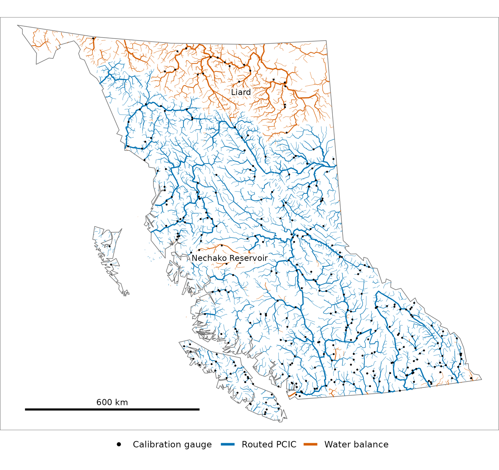
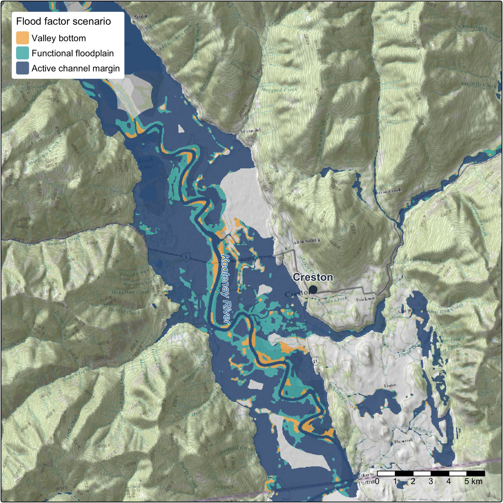
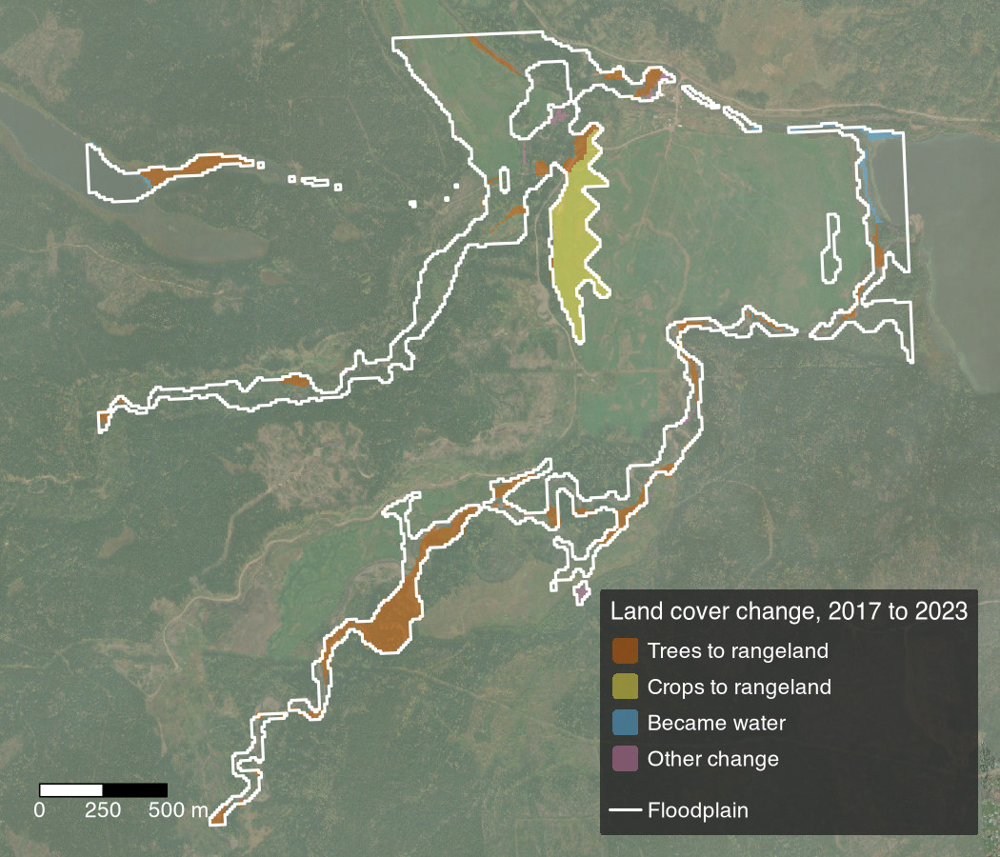
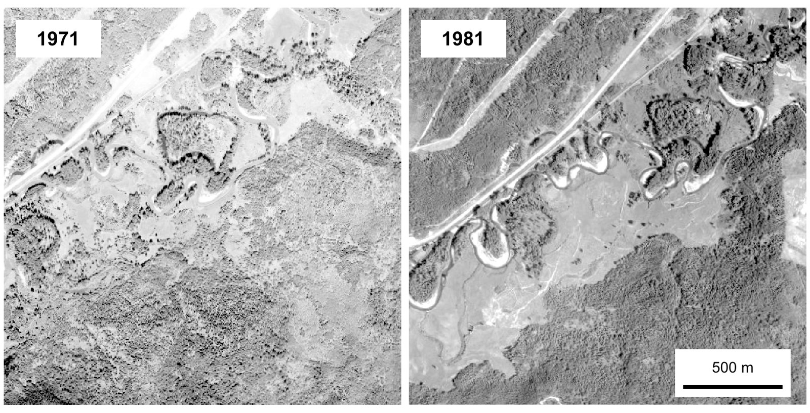
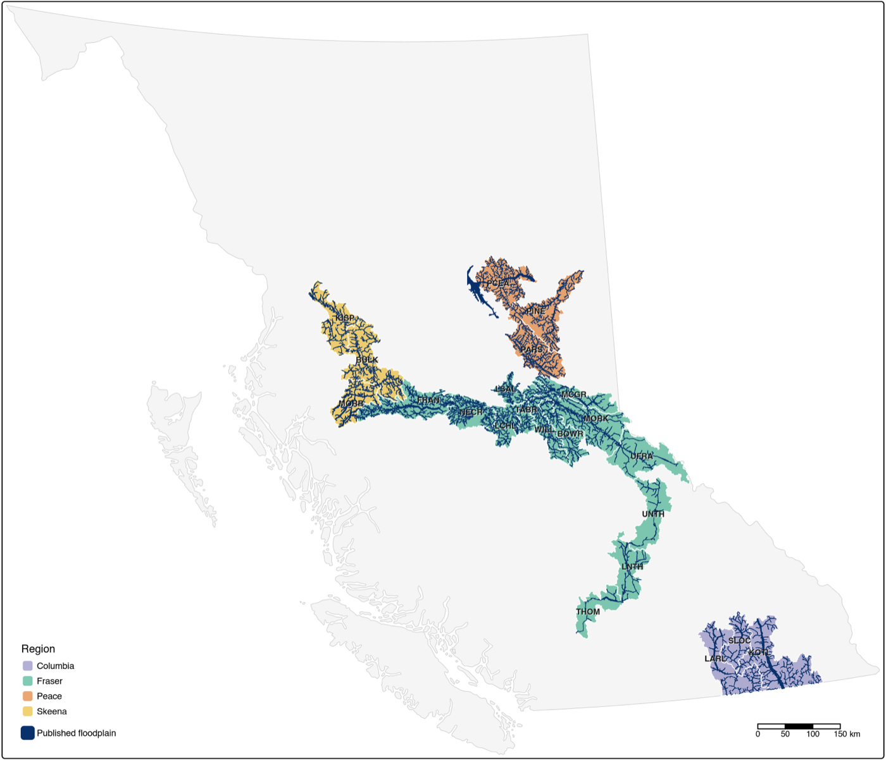
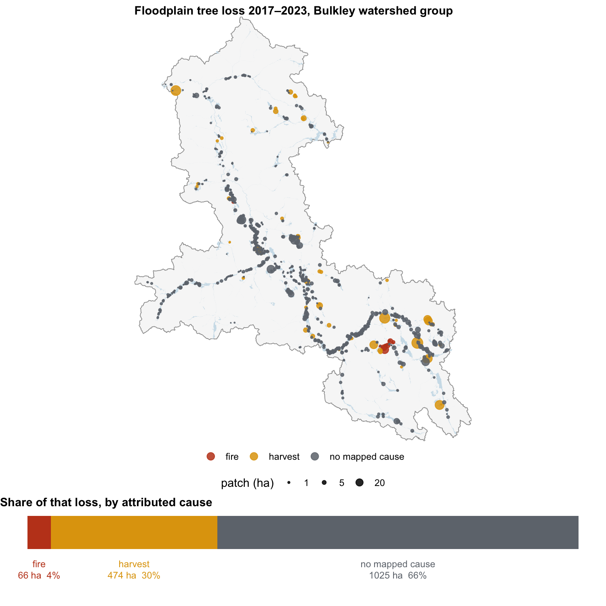
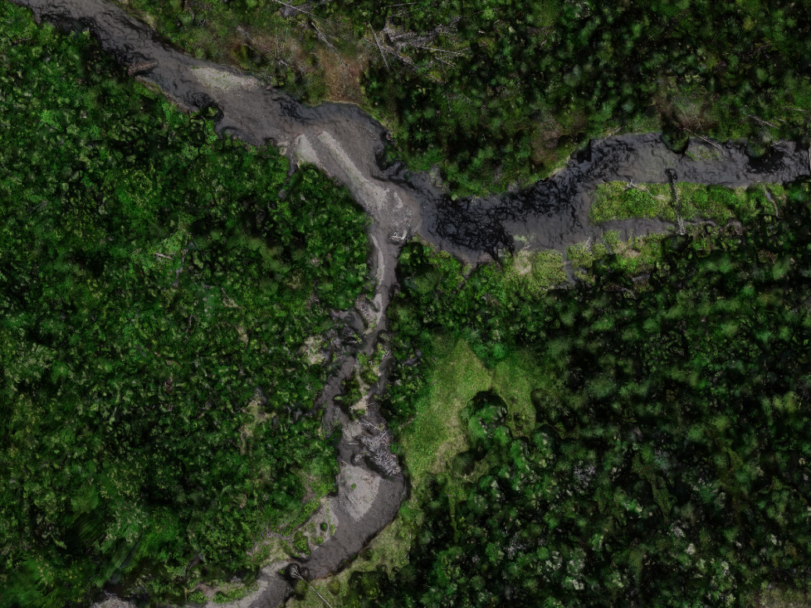

Our analytical tools, data, and methods are publicly available on GitHub. We work in the open wherever transparency improves science. The tools are built and extended through our partner programs, so each project strengthens the tools the next one uses. For how the pieces fit together, from fish evidence to the floodplain, see [Habitat rules, tested and carried onto the floodplain](https://www.newgraphenvironment.com/new_graphiti/posts/2026-11-01-habitat-rules-tested/).

## Where is the habitat, and what's keeping fish from it?

For restoration planning, the first questions are where each species' habitat is and which barriers cut fish off from it. Field results flow back into the answer.

### link and fresh — habitat potential, species by species

Our habitat connectivity model, link, maps the intrinsic habitat potential of streams for each species: where spawning and rearing habitat can be, whether fish can reach it, and which barrier is in the way. The fish habitat definitions can be tuned for each species and [tested against where fish have actually been found](#knowledge--testing-fish-habitat-definitions-against-the-evidence). It builds on the methods of bcfishpass, the fish passage model built by Simon Norris and maintained with contributions from many groups.

link runs on our stream network engine, fresh, which places surveys on streams, walks the network and applies the habitat definitions. It works on BC's Freshwater Atlas through [fwapg](https://smnorris.github.io/fwapg/), which loads the Atlas into a spatial database.

- link: [Documentation](https://www.newgraphenvironment.com/link/) | [Source](https://github.com/NewGraphEnvironment/link)
- fresh: [Documentation](https://www.newgraphenvironment.com/fresh/) | [Source](https://github.com/NewGraphEnvironment/fresh)

### wet — flow and water temperature

Our stream flow tool, wet, estimates mean annual and monthly flow for almost every stream in the Freshwater Atlas, checked against hydrometric gauges. At gauging stations it adds daily flow and, where the station logs it, water temperature.

The flow can feed the fish habitat definitions. At gauging stations, our climate analysis tool, cd (below), compares flow during key life stages, such as chinook migration and spawning, with long-term normals, and water temperature with the recent record.

- [Documentation](https://www.newgraphenvironment.com/wet/) | [Source](https://github.com/NewGraphEnvironment/wet)

### knowledge — testing fish habitat definitions against the evidence

Our evidence tool, knowledge, tests fish habitat definitions against what we know about where fish live. It brings together the Province's fish sampling records, past reports and the published literature, and tunes link's habitat definitions from the fish records where they allow, checking each on parts of the province it was not chosen from. Its results record how they were made, so they can be checked, rerun and built on.

- [Documentation](https://www.newgraphenvironment.com/knowledge/) | [Source](https://github.com/NewGraphEnvironment/knowledge) | [How a habitat definition is tested](https://www.newgraphenvironment.com/knowledge/articles/habitat_thresholds.html) | [Chinook rearing, worked through](https://www.newgraphenvironment.com/knowledge/articles/chinook_rearing.html)

---

## Where is the floodplain, what did it look like before, and what has changed?

The floodplain is where a river stores water, builds side channels and grows the wood that becomes its pools and cover. Restoring at the scale of the loss means seeing the whole floodplain: where it is, its condition before clearing and channelisation, and what is changing now.

### flooded — where the floodplain is

Our floodplain mapping tool, flooded, maps the floodplain from an elevation model and the stream network. It runs on any elevation model, from the 30 m national model that covers all of Canada to 1 m provincial lidar, and its settings can be varied to map anything from the active channel out to the whole valley bottom, so each run is a scenario to compare with the others. The finer the elevation model, the more closely the mapped floodplain follows the ground as it is now. On lidar it shows where road and rail grades, dykes and fill disconnect parts of a floodplain from its river, and the marks other development has left on it: wetlands drained, streams ditched into straight channels, ground regraded for roads, farms and towns. Each part of a floodplain can be assigned to the streams it belongs to, so habitat joins it by position and a new fish habitat definition does not redraw the ground. That shows **where to look, and what to check before acting**: disconnection, drainage, channelisation and fill.

- [Documentation](https://www.newgraphenvironment.com/flooded/) | [Source](https://github.com/NewGraphEnvironment/flooded)

### drift — what has changed

Our land-cover change tool, drift, measures how the land inside a floodplain changed between any two years that free satellite land-cover maps cover. It tags each change with what it overlaps in any mapped layer of areas, such as fire perimeters or cutblocks. It is a screening tool: each change it finds is a place to check, not confirmed loss.

- [Documentation](https://www.newgraphenvironment.com/drift/) | [Source](https://github.com/NewGraphEnvironment/drift)

### cd — climate departure

Our climate analysis tool, cd, measures how far a watershed's climate has moved from a baseline since 1950: temperature, precipitation, drying, soil moisture and snowpack. It also gives the trend in any yearly series, such as flow from wet. This is the climate context for deciding which watersheds and life stages are under the most pressure.

- [Documentation](https://www.newgraphenvironment.com/cd/) | [Source](https://github.com/NewGraphEnvironment/cd)

### fly — historic airphotos

Our airphoto tool, fly, puts British Columbia's historic airphotos back on the map, for free. The province's catalogue gives each photo only an approximate centre point, not the ground it covers. fly works out that ground from the photo's scale and the aircraft's height above the land, orients each photo by its flight line and film roll, masks the scanned border, and places the province's free thumbnails on their footprints as georeferenced images. The photos show a valley as it was decades ago, often before roads, farming and logging changed it: a reference for what to restore toward, and the history that conservation and restoration planning draws on to tell a place's story. Where full scans are worth ordering, fly picks the fewest photos that cover a site. Georeferenced thumbnails are served in our airphoto catalogue, [stac_airphoto_bc](https://www.newgraphenvironment.com/stac_airphoto_bc/).

- [Documentation](https://www.newgraphenvironment.com/fly/) | [Source](https://github.com/NewGraphEnvironment/fly)

### Floodplain change catalogue

Brings link, flooded and drift together for whole watershed groups: the floodplain of each group's whole stream network, tree loss and gain inside it from 2017 to 2023, and how much of that loss coincides with fire or harvest. It loads straight into QGIS, R or Python, and the code that builds it is open.

**A screening tool for finding where to look.** It has not been field-validated, and watershed groups can't be compared with each other.

- [Floodplains](https://www.newgraphenvironment.com/floodplains/) | [Catalogue](https://www.newgraphenvironment.com/stac_floodplains_bc/) | [Source](https://github.com/NewGraphEnvironment/floodplains)

---

## What do the ground and water look like now?

Understanding a floodplain means seeing it as it is now and as it was. We built open catalogues of provincial lidar and the drone imagery from our programs, and an open archive of hydrometric station data, so this data can be found and loaded directly. They take down the barriers to sharing it: anyone can find imagery and elevation data by place, by script or by hand in QGIS, query the station records by script, and pull either into a model, a report or a map. Partners and practitioners can see for themselves what is happening on their rivers.

### BC lidar, ready to query

LidarBC elevation tiles across the province, searchable by place and date: bare earth and, where published, surface models, new tiles added monthly, with an index of the raw point clouds. Bare earth shows side channels, old channels and the fill built across a river's path. The point clouds give the height of the streamside forest, and where it has been cleared.

- [Elevation catalogue](https://www.newgraphenvironment.com/stac_elevation_bc/) | [Point cloud catalogue](https://www.newgraphenvironment.com/stac_pointcloud_bc/)

### Drone imagery

Drone imagery from our programs, stitched with OpenDroneMap into orthomosaics and, for nearly all flights, elevation models. Each flight is catalogued by place, stream and date, so it can be found from R, Python or QGIS, or opened in our purpose-built viewer. Imagery flown before works are built is the baseline later flights are compared against. Flights are by our team and, in the Neexdzii Kwah, with the Ministry of Water, Land and Resource Stewardship's provincial drone specialist.

- [Catalogue](https://www.newgraphenvironment.com/stac_uav_bc/) | [Viewer](https://viewer.a11s.one) | [Source](https://github.com/NewGraphEnvironment/stac_uav_bc)

### water-temp-bc — water temperature, flow and water level

Our hydrometric archive, water-temp-bc, holds water temperature, flow and water level from federal hydrometric stations across BC. It is refreshed monthly from Environment and Climate Change Canada's real-time service and kept month over month, with water temperature back to 2002 and daily flow back to 2016, ready to query from R.

This data feeds our collaborative science with [Poisson Consulting](https://www.poissonconsulting.ca/) and [Hillcrest Geographics](https://hillcrestgeo.ca/), which is advancing fish habitat modelling across the province. That collaboration has produced spatial stream network temperature modelling ([Skeena 2025](https://www.poissonconsulting.ca/f/1130667589), [Nechako 2022](https://www.poissonconsulting.ca/f/1295467017)) and channel width regression models.

- [Data](https://www.newgraphenvironment.com/water-temp-bc/) | [Source](https://github.com/NewGraphEnvironment/water-temp-bc)

### Open catalogues, and the recipe for building them

Each catalogue is two things: the catalogue itself, and the public code that builds it, a worked example others can follow to build their own. We don't need to be the only source of any of it. Ours are served from our catalogue server, [images.a11s.one](https://images.a11s.one), and can be searched from R, Python or QGIS 3.42+ through the open STAC standard. Four of the five carry a CC BY 4.0 licence.

Our catalogue loader, stacs, puts catalogues into that search service and checks that every record arrived intact.

- [stacs documentation](https://www.newgraphenvironment.com/stacs/) | [Source](https://github.com/NewGraphEnvironment/stacs)

{}

---

## Into the field and back

We take the planning into the field. For each program we build a custom field system: styled map projects of the watershed carrying our analysis and provincial data, and digital forms that work offline on phones and tablets. The whole crew works in one shared project, and changes sync between field and office.

Forms cover fish passage assessment, habitat confirmation, effectiveness monitoring, restoration site investigation, eDNA sampling and benthic invertebrate collection. Where possible, data is structured for direct submission to the provincial and federal databases: FISS for fish, PSCIS for stream crossings and CABIN for benthic invertebrates. What crews collect flows back into the models it came from: assessments and habitat confirmations feed link's barrier decisions.

We also build the capacity of field teams to navigate to sites, collect data to standard, and interpret what they find.

### Dynamic reporting

One set of source files produces both an interactive online report and a print-ready PDF, with maps, figures, tables, cross-references and citations. When new data arrives or methods are refined, the report rebuilds. Every change is tracked, and most reports are publicly accessible. Our citation checker, [cred](https://www.newgraphenvironment.com/cred/), finds the best-matching passage for each citation, or the abstract where no source file is attached, so it can be reviewed.

See live reports in our [Watershed Restoration & Conservation](/project/watershed_restoration_fish_passage/) and [Aquatic Monitoring & Assessment](/project/aquatic_monitoring_assessment/) work.
