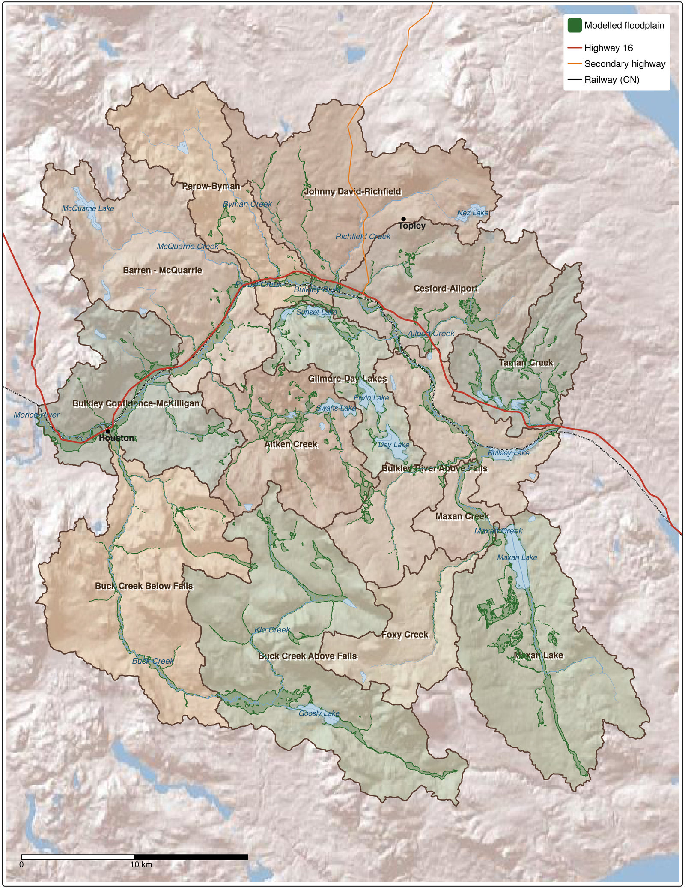
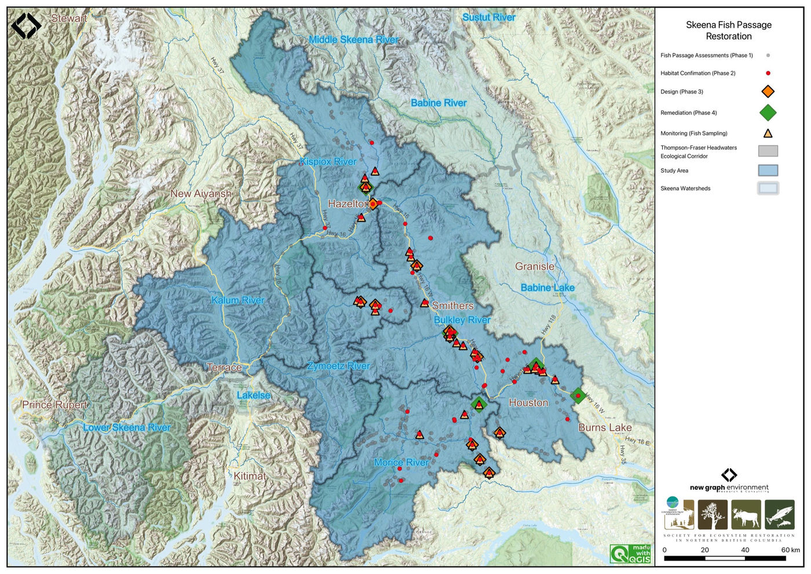
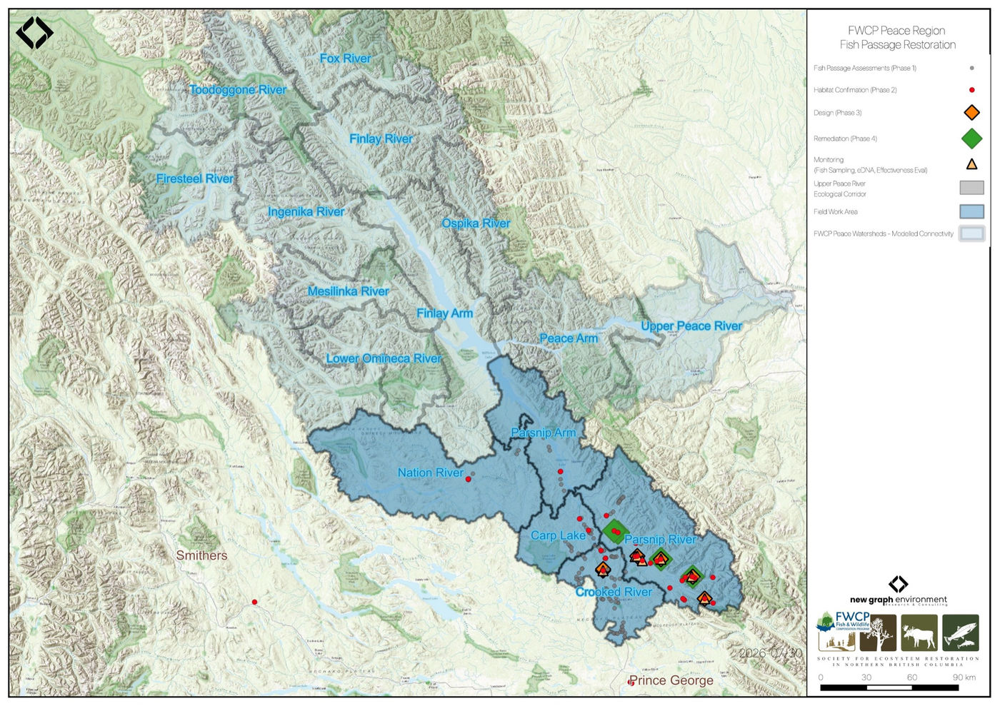
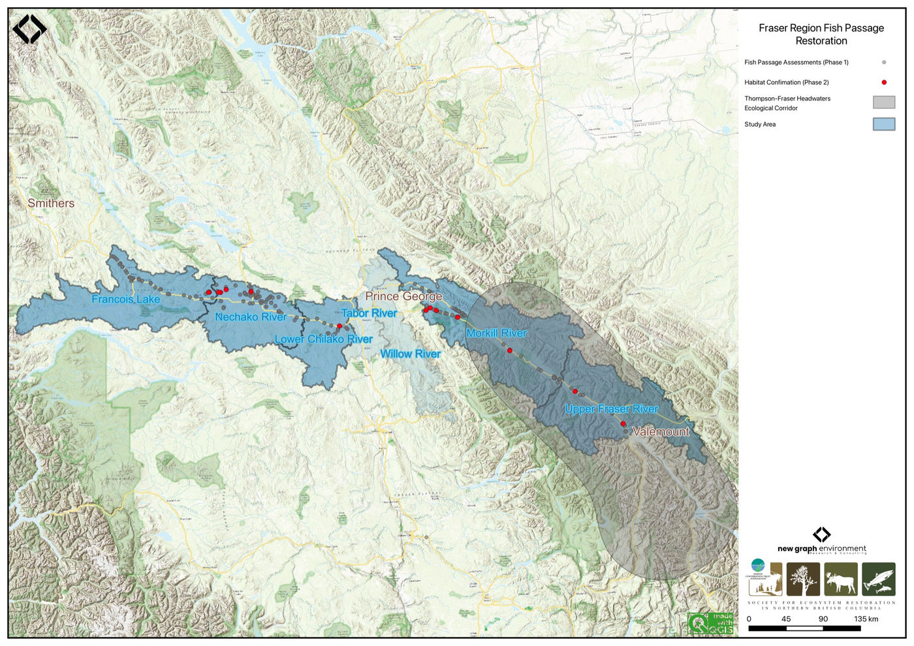
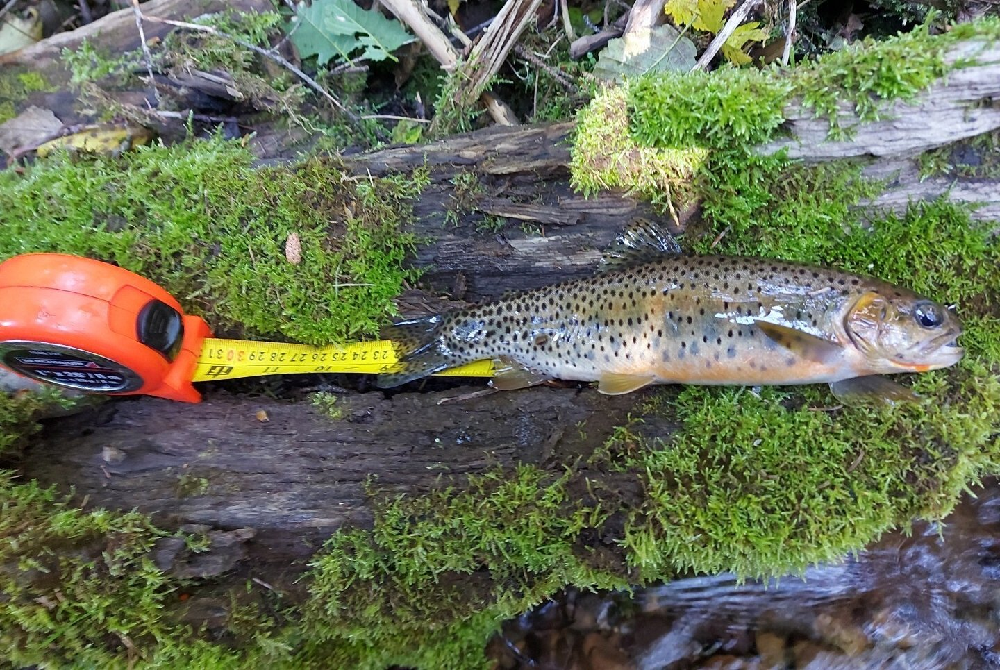

We plan, deliver and monitor aquatic restoration at scales ranging from individual stream crossings to entire watersheds. Our work integrates floodplain analysis, land cover change detection, riparian assessment, aquatic monitoring, and fish passage barrier prioritization — connecting field observations to watershed-scale planning through open-source tools and collaborative GIS.

We monitor restoration effectiveness over the long term with standardised biological tools: eDNA, benthic invertebrate sampling, fish inventories for the provincial database (FISS), fish and fish habitat assessment, drone surveys, and riparian assessment. The systems we have built track progress and effectiveness and share the results with partners, so what we learn at one site carries to the next.

### Neexdzii Kwah Watershed Restoration

The Neexdzii Kwah (Upper Bulkley River) has some of the most intense land use in the Skeena Basin, as the 2024 restoration plan documents. This initiative develops a living governance and prioritization framework for watershed restoration — placing Wet'suwet'en direction at the centre of decision-making and integrating open-source spatial analysis tools to support planning at the sub-basin scale.

The watershed was divided into 14 sub-basins to enable comparison and investment targeting. Floodplain modelling mapped where tree cover appears to have been lost over 2017–2023. Field reviews at 26 locations documented conditions ranging from successful past restoration to riparian degradation far exceeding past investment footprints. A collaborative GIS project integrates all analysis outputs and travels into the field on mobile devices.

  - [Neexdzii Kwah Restoration Planning](https://www.newgraphenvironment.com/restoration_wedzin_kwa_2024/)
  - [Benthic Invertebrate Assessment of the Neexdzii Kwa — 2025](https://www.newgraphenvironment.com/neexdzii_kwa_benthic_2025/)

This work is conducted on behalf of the Wet'suwet'en Treaty Office Society, delivered under the leadership of the Society for Ecosystem Restoration in Northern BC (SERNbc), with technical implementation by New Graph Environment.

### Fish Passage Restoration Planning

Multi-year fish passage assessment and restoration planning across more than 20 watershed groups in British Columbia. We collaborate with First Nations, provincial agencies, and stewardship organizations to identify barriers, prioritize restoration, and track outcomes. The Skeena, Fraser and Peace programs are delivered with SERNbc: for the Habitat Conservation Trust Foundation and the Ministry of Transportation and Infrastructure in the Skeena and Fraser, and for the Fish and Wildlife Compensation Program in the Peace. The Elk River work was for Nupqu Resource Limited Partnership, and the 2022 effectiveness monitoring for the Ministry of Transportation and Infrastructure. Each report is a living document: it rebuilds when new data or review comments arrive, and the version and date on its title page say where it stands.

#### Skeena Region

  - [Restoring Fish Passage in the Skeena Region 2025](https://www.newgraphenvironment.com/fish_passage_skeena_2025_reporting/)

Previous Skeena reports

  - [Skeena Watershed Fish Passage Restoration Planning 2024](https://www.newgraphenvironment.com/fish_passage_skeena_2024_reporting/)
  - [Skeena Watershed Fish Passage Restoration Planning 2023](https://www.newgraphenvironment.com/fish_passage_skeena_2023_reporting/)
  - [Skeena Watershed Fish Passage Restoration Planning 2022](https://www.newgraphenvironment.com/fish_passage_skeena_2022_reporting/)
  - [Bulkley Watershed Fish Passage Restoration Planning 2022](https://www.newgraphenvironment.com/fish_passage_bulkley_2022_reporting/)
  - [Bulkley River and Morice River Watershed Groups Fish Passage Restoration Planning 2021](https://www.newgraphenvironment.com/fish_passage_skeena_2021_reporting/)
  - [Bulkley River and Morice River Watershed Groups Fish Passage Restoration Planning 2020](https://www.newgraphenvironment.com/fish_passage_bulkley_2020_reporting/)

#### Peace Region

  - [Restoring Fish Passage in the Peace Region 2025](https://www.newgraphenvironment.com/fish_passage_peace_2025_reporting/)
  - [Restoring Fish Passage in the Peace Region 2024](https://www.newgraphenvironment.com/fish_passage_peace_2024_reporting/)

Previous Peace reports

  - [Restoring Fish Passage in the Peace Region 2023](https://www.newgraphenvironment.com/fish_passage_peace_2023_reporting/)
  - [Restoring Fish Passage in the Peace Region 2022](https://www.newgraphenvironment.com/fish_passage_peace_2022_reporting/)
  - [Restoring Fish Passage in the Peace Region 2021](https://www.newgraphenvironment.com/fish_passage_parsnip_2021_reporting/)
  - [Parsnip River Watershed – Fish Habitat Confirmations 2019](https://www.newgraphenvironment.com/Parsnip_Fish_Passage/)

#### Fraser Region

  - [Restoring Fish Passage in the Fraser Region 2025](https://www.newgraphenvironment.com/fish_passage_fraser_2025_reporting/)
  - [Restoring Fish Passage in the Fraser Region 2023](https://www.newgraphenvironment.com/fish_passage_fraser_2023_reporting/)

#### Elk River

  - [Elk River Watershed Group Fish Passage Restoration Planning 2022](https://www.newgraphenvironment.com/fish_passage_elk_2022_reporting/)

Previous Elk reports

  - [Elk River Watershed Group Fish Passage Restoration Planning 2021](https://www.newgraphenvironment.com/fish_passage_elk_2021_reporting/)
  - [Upper Elk River and Flathead River Fish Passage Restoration Planning 2020](https://www.newgraphenvironment.com/fish_passage_elk_2020_reporting/)

#### Effectiveness Monitoring

  - [Effectiveness Monitoring for Cross Creek, Bittner Creek and Five Mile Creek - 2022](https://www.newgraphenvironment.com/fish_passage_moti_2022_reporting/)

